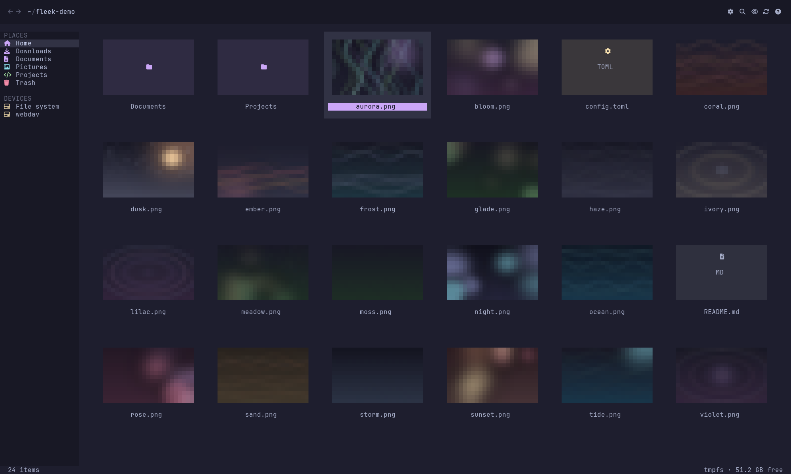
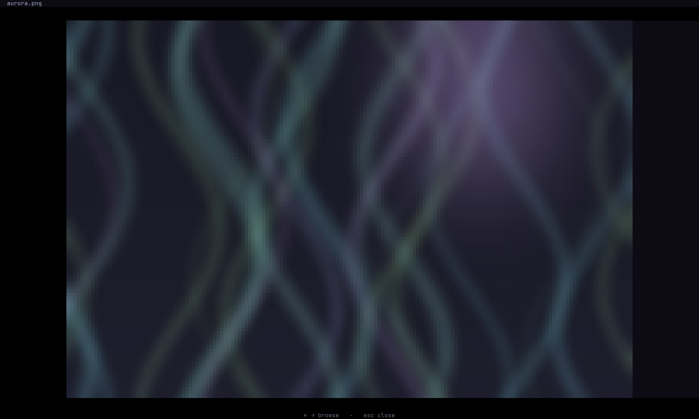
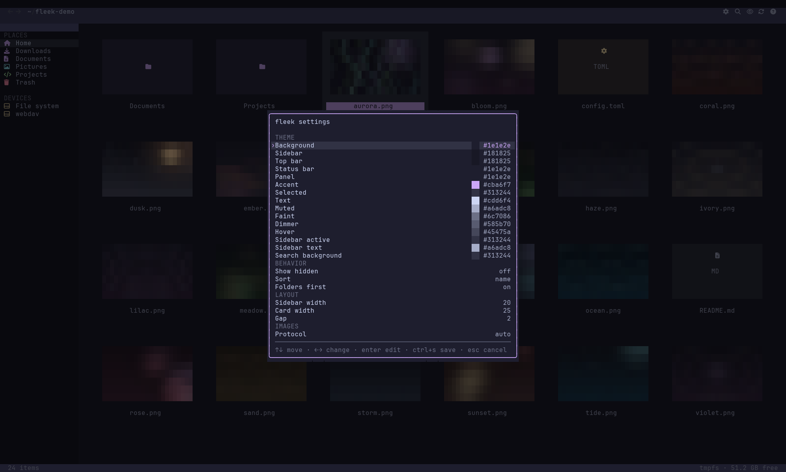
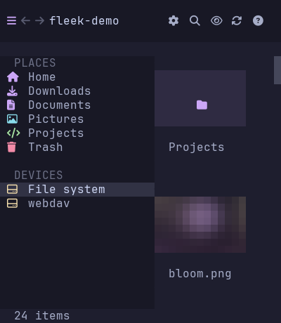

# fleek

[](https://go.dev)
[](#requirements)
[](#images-and-tmux)
[](LICENSE)

A terminal file manager with real thumbnails and a responsive grid/list layout,
built for Ghostty and tmux.



*Actual 200×60 half-block capture. Demo artwork is generated for the screenshots.*

## Why fleek?

- **See the file before you open it.** Images, videos and PDFs get real 3:2
  thumbnails, loaded lazily and cached on disk.
- **Built for the terminal you already use.** Kitty graphics with Unicode
  placeholders in Ghostty, Kitty and WezTerm, including inside tmux. Everything
  else gets a colored half-block fallback.
- **Fast to drive.** Arrows or `hjkl` for the grid or list, `/` or `ctrl+f` for
  recursive search, and a right-click menu for copy, cut, rename, trash and new
  folders.
- **Fits the window you have.** Full sidebar on wide terminals, and a two-column
  thumbnail grid with a sidebar drawer on narrow phone-sized windows.
- **One binary, your config.** A single Go binary with TOML themes, layout,
  sorting and extra sidebar places. No daemon, no Electron.

## Screenshots

All screenshots are half-block captures from the current build.

| Full-screen viewer | File actions |
|:---:|:---:|
|  |  |
| **Full-screen viewer** — `space` opens the selected image; arrows browse. | **File actions** — right-click or `m` to open, copy, cut, rename or trash. |

| Keyboard help | Settings |
|:---:|:---:|
|  |  |
| **Keyboard help** — every binding, scrollable in short windows. | **Settings** — theme, behavior, layout and image protocol, with a live preview. |

| Phone grid | Phone sidebar |
|:---:|:---:|
|  |  |
| **Phone grid** — two-column thumbnails below 60 columns. | **Sidebar drawer** — full labels instead of an icon rail. |

## Features

- 3:2 thumbnails for images, videos and PDFs
- Nerd Font folder tiles and file-type icons
- Places sidebar with mounted filesystems and free space
- Right-click a folder to add it to the sidebar, or remove it again
- Multi-select with shift/ctrl-click, shift+arrows or `ctrl+a`
- Tabs with independent directory, history, selection and scroll
- Responsive thumbnail grid on desktop and phones
- Sidebar drawer toggle on phones
- Selection borders, breadcrumbs and navigation history
- Recursive search across the current tree (`/`)
- Type-to-filter the current folder (`f`)
- Copy, cut, paste, rename, trash and new-folder actions
- Zip and tar.gz compress/extract from the context menu
- Batch rename with `{name}`, `{ext}` and `{n}`
- Restore or empty the Trash
- File properties, permissions, ownership, copy path, open with, duplicate and symlink actions
- Right-click context menu with an advanced actions page
- Full-screen image, video, PDF and text viewer
- Lazy thumbnail loading and a disk cache
- Kitty graphics for Ghostty/Kitty/WezTerm, with a half-block fallback
- Catppuccin Mocha palette by default
- TOML configuration for theme, layout, behavior and extra places
- In-app settings window with live theme preview and save-to-TOML

## Requirements

- Linux
- Go 1.27 or newer to build
- A terminal with a Nerd Font installed
- Optional: `ffmpeg` for video frames
- Optional: `pdftoppm` from poppler for PDF pages

## Install

From a checkout:

```sh
git clone https://github.com/StefanVonRanda/fleek.git
cd fleek
./install.sh
```

`install.sh` builds `fleek`, installs it to `~/.local/bin` (or `$PREFIX/bin`),
and writes a starter config to `~/.config/fleek/config.toml` if you do not have
one yet.

Or use Go directly:

```sh
go install github.com/StefanVonRanda/fleek@latest
```

Run `fleek` with no arguments to open the current directory:

```sh
cd ~/Pictures
fleek
```

Pass a directory to open it, or a file to open its parent with that file selected.

## Usage

| Key | Action |
| --- | --- |
| `←` `↑` `↓` `→`, `hjkl` | move in the grid or list |
| `shift+click` / `ctrl+click` | select a range / toggle selection |
| `shift+arrows` | extend selection |
| `ctrl+a` | select all |
| `t` | toggle selection at the cursor |
| `ctrl+t` / `ctrl+w` | new tab / close tab |
| `ctrl+tab` or `[` / `]` | switch tabs |
| `enter` / double-click | open folder or file |
| double-click image | full-screen viewer |
| `space` | preview image, video, PDF or text |
| `c` / `x` / `v` | copy / cut / paste |
| `F2` | rename |
| `R` | batch rename selected items |
| `n` | new folder |
| `Del` | move to trash |
| `m` / right-click | actions menu (`More…` for advanced actions) |
| `backspace` | parent folder |
| `alt+←` / `alt+→` | back / forward |
| `~` | home |
| `.` | show or hide dotfiles |
| `/` or `ctrl+f` | recursive search |
| `f` | filter the current folder |
| `o` | reverse sort |
| `tab` | jump to the sidebar / toggle the mobile drawer |
| `r` | refresh |
| `s` / `ctrl+,` | settings and theme |
| `?` | help |
| `q` / `ctrl+c` | quit (`ctrl+c` works from any view) |

Mouse clicks select; double-click opens. The wheel scrolls. Sidebar places,
breadcrumbs and toolbar icons are clickable. Right-click a folder to add or
remove it from the sidebar. Shift+click selects a range; if your terminal
reserves shift+click for text selection, set Ghostty's
`mouse-shift-capture = true` or use `alt+click` for the same range. On phones,
the top-left toggle (or `tab`) opens the sidebar drawer.

The actions menu includes **More…** for archive, batch rename, properties,
permissions, ownership, copy path, open with, duplicate, symlink and terminal
actions.

Search results show paths relative to the current directory. `esc` closes search
and restores the folder; `enter` opens the selected result.

### Small terminals

Below 90 columns the sidebar becomes a drawer toggled from the top bar, and the
grid uses two thumbnail columns. The help panel scrolls with `j`/`k`, arrow keys
or the wheel. Search expands to the full path bar under 50 columns, and menus and
dialogs size themselves to the window.

## Configuration

fleek reads `~/.config/fleek/config.toml` (`$XDG_CONFIG_HOME/fleek/config.toml`)
by default. Use `--config PATH` or `FLEEK_CONFIG` to load another file.
`examples/config.toml` is the complete annotated example.

Press `s` (or `ctrl+,`) to open the settings window. It edits the theme palette,
behavior, layout and image protocol with a live preview. `ctrl+s` (or `s`) saves
to the active config file and `esc` discards the changes. Saving settings or a
bookmark rewrites the file, so comments in a hand-edited config are not preserved.

```toml
[theme]
background = "#1e1e2e"
accent = "#cba6f7"
text = "#cdd6f4"

[behavior]
show_hidden = false
sort = "name"              # name, size, modified
sort_reverse = false
directories_first = true

[layout]
sidebar_width = 20         # 14-32 (preferred; hidden below 36 columns)
card_width = 25            # 25-40
gap = 2                    # 1-4

[images]
protocol = "auto"          # auto, tgp, halfblock
```

The full palette, every layout key and custom places live in
[`examples/config.toml`](examples/config.toml).

### Extra places

```toml
[[places]]
label = "Code"
path = "~/code"
icon = "code"
color = "#89b4fa"
```

Available icon names are `home`, `download`, `document`, `music`, `picture`,
`video`, `code`, `trash`, `disk`, `bookmark` and `folder`.

Right-click a folder and choose **Add to sidebar** to append it to this list.
The same menu removes bookmarks you added.

### Environment overrides

| Variable | Purpose |
| --- | --- |
| `FLEEK_PROTOCOL` | `tgp` or `halfblock` |
| `FLEEK_CACHE_DIR` | thumbnail cache root (default: `~/.cache/fleek`) |
| `FLEEK_FONT` | path to a Nerd Font used to render large folder glyphs |
| `FLEEK_CONFIG` | alternative config file path |

Thumbnails and preview images are cached under `~/.cache/fleek/thumbs`. The cache
is safe to delete.

## Images and tmux

fleek chooses the image renderer at startup:

- Ghostty, Kitty, WezTerm: Kitty graphics with Unicode placeholders
- everything else: colored half blocks

Inside tmux, Kitty graphics require passthrough:

```tmux
set -g allow-passthrough on
set -ga terminal-features ',xterm-ghostty:RGB'
```

The second line advertises truecolor support to tmux. Without it, tmux may
quantize the image-ID colors and thumbnails will not render correctly.

Force a renderer when needed:

```sh
FLEEK_PROTOCOL=halfblock ./fleek ~/Pictures
FLEEK_PROTOCOL=tgp ./fleek ~/Pictures
```

The screenshots above use the half-block renderer:
[grid](docs/images/grid-halfblock.png),
[viewer](docs/images/viewer-halfblock.png). It is also what terminals without
Kitty graphics show.

## Current limitations

- Linux is the supported platform for mount and font discovery.
- Sixel is not supported.
- Split panes, drag-and-drop and mounting/ejecting are not implemented yet.
- Overwrite/skip conflict prompts, operation progress/cancel and undo are not implemented yet.
- Video and PDF thumbnails require the optional external tools above.

## License

MIT
