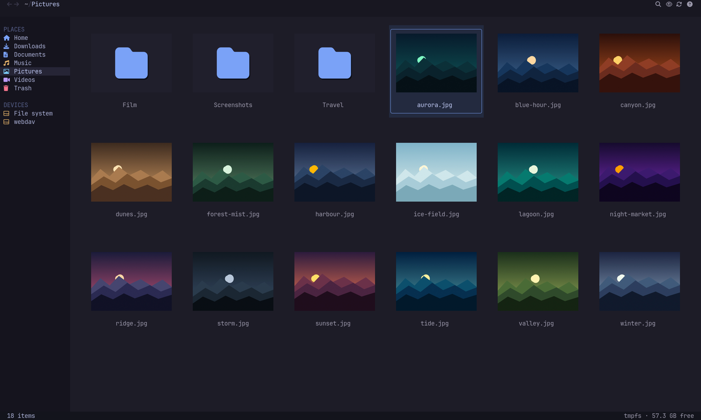
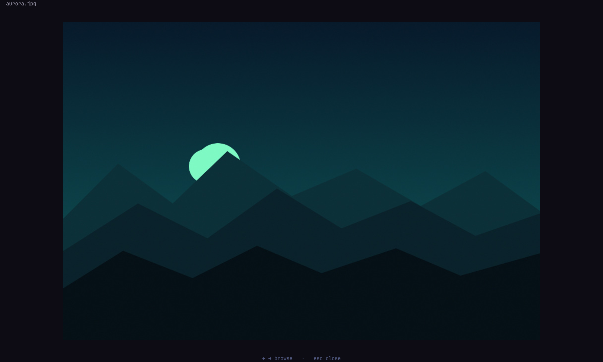
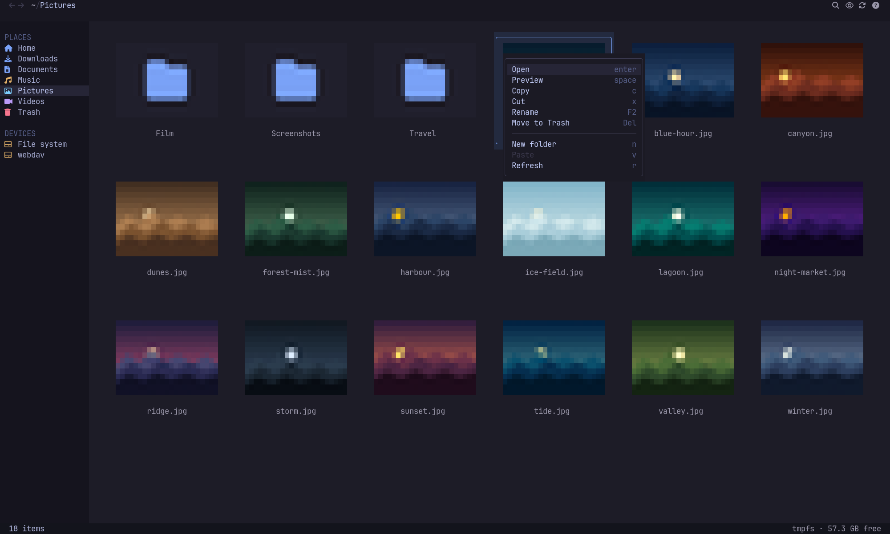
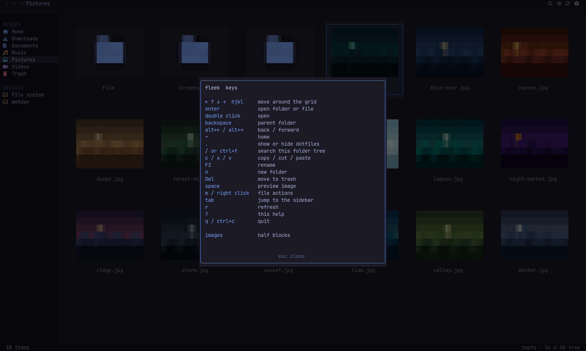
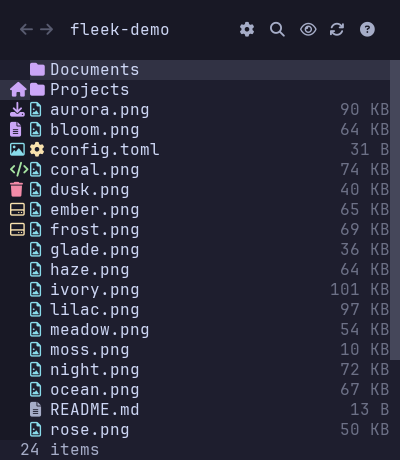

# fleek

[](https://go.dev)
[](#requirements)
[](#images-and-tmux)
[](LICENSE)

A grid-first terminal file manager with real thumbnails, built for Ghostty and tmux.



*Ghostty preview (composited). The terminal frame, text and layout are a real
200×50 capture from foot; only the thumbnail cells are filled with the same
480×320 images fleek uploads through the Kitty graphics protocol.
[See the unmodified half-block capture](docs/images/grid-halfblock.png).
Demo artwork is original.*

## Why fleek?

- **See the file before you open it.** Images, videos and PDFs get real 3:2
  thumbnails, loaded lazily and cached on disk.
- **Built for the terminal you already use.** Kitty graphics with Unicode
  placeholders in Ghostty, Kitty and WezTerm, including inside tmux. Everything
  else gets a colored half-block fallback.
- **Fast to drive.** Arrows or `hjkl` for the grid, `/` or `ctrl+f` for
  recursive search, and a right-click menu for copy, cut, rename, trash and new
  folders.
- **Fits the window you have.** Full sidebar on wide terminals, an icon rail in
  the middle, a single-column grid on a phone-sized 40×23 window.
- **One binary, your config.** A single Go binary with TOML themes, layout,
  sorting and extra sidebar places. No daemon, no Electron.

## Screenshots

| Full-screen viewer | File actions |
|:---:|:---:|
|  |  |
| **Full-screen viewer** — `space` opens the selected image; arrows browse. *Ghostty preview (composited): UI from a real foot capture; image area filled at full resolution. [Unmodified capture](docs/images/viewer-halfblock.png).* | **File actions** — right-click or `m` to open, copy, cut, rename or trash. *Unmodified half-block capture.* |
|  | <p align="center"></p> |
| **Keyboard help** — every binding, scrollable in short windows. *Unmodified half-block capture.* | **Phone-sized terminal** — 40×23, icon rail and one-column grid. *Unmodified half-block capture.* |

The grid and viewer previews are composited from real captures and are labeled
as such. The menu, help and phone screenshots are unmodified.

## Features

- 3:2 thumbnails for images, videos and PDFs
- Nerd Font folder tiles and file-type icons
- Places sidebar with mounted filesystems and free space
- Responsive grid, selection borders, breadcrumbs and history
- Recursive search across the current tree (`/`)
- Copy, cut, paste, rename, trash and new-folder actions
- Right-click context menu, plus keyboard equivalents
- Full-screen viewer with arrow-key browsing
- Lazy thumbnail loading and a disk cache
- Kitty graphics for Ghostty/Kitty/WezTerm, with a half-block fallback
- TOML configuration for theme, layout, behavior and extra places

## Requirements

- Linux
- Go 1.27 or newer to build
- A terminal with a Nerd Font installed
- Optional: `ffmpeg` for video frames
- Optional: `pdftoppm` from poppler for PDF pages

## Install

From a checkout:

```sh
git clone https://github.com/StefanVonRanda/fleek.git
cd fleek
./install.sh
```

`install.sh` builds `fleek`, installs it to `~/.local/bin` (or `$PREFIX/bin`),
and writes a starter config to `~/.config/fleek/config.toml` if you do not have
one yet.

Or use Go directly:

```sh
go install github.com/StefanVonRanda/fleek@latest
```

Run `fleek` with no arguments to open the current directory:

```sh
cd ~/Pictures
fleek
```

Pass a directory to open it, or a file to open its parent with that file selected.

## Usage

| Key | Action |
| --- | --- |
| `←` `↑` `↓` `→`, `hjkl` | move in the grid |
| `enter` / double-click | open folder or file |
| double-click image | full-screen viewer |
| `space` | preview selected image |
| `c` / `x` / `v` | copy / cut / paste |
| `F2` | rename |
| `n` | new folder |
| `Del` | move to trash |
| `m` / right-click | file actions menu |
| `backspace` | parent folder |
| `alt+←` / `alt+→` | back / forward |
| `~` | home |
| `.` | show or hide dotfiles |
| `/` or `ctrl+f` | recursive search |
| `tab` | jump between the grid and sidebar |
| `r` | refresh |
| `?` | help |
| `q` / `ctrl+c` | quit (`ctrl+c` works from any view) |

Mouse clicks select; double-click opens. The wheel scrolls. Sidebar places,
breadcrumbs and toolbar icons are clickable.

Search results show paths relative to the current directory. `esc` closes search
and restores the folder; `enter` opens the selected result.

### Small terminals

Below 90 columns the sidebar collapses to a three-column icon rail; below 36
columns it is hidden and the grid uses the full width. The help panel scrolls
with `j`/`k`, arrow keys or the wheel. Search expands to the full path bar under
50 columns, and menus and dialogs size themselves to the window.

## Configuration

fleek reads `~/.config/fleek/config.toml` (`$XDG_CONFIG_HOME/fleek/config.toml`)
by default. Use `--config PATH` or `FLEEK_CONFIG` to load another file. Settings
are applied at startup; `examples/config.toml` is the complete annotated example.

```toml
[theme]
background = "#1d1c27"
accent = "#7aa2f7"
text = "#c0caf5"

[behavior]
show_hidden = false
sort = "name"              # name, size, modified
directories_first = true

[layout]
sidebar_width = 20         # 14-32 (preferred; hidden below 36 columns)
card_width = 25            # 25-40
gap = 2                    # 1-4

[images]
protocol = "auto"          # auto, tgp, halfblock
```

The full palette, every layout key and custom places live in
[`examples/config.toml`](examples/config.toml).

### Extra places

```toml
[[places]]
label = "Code"
path = "~/code"
icon = "code"
color = "#7aa2f7"
```

Available icon names are `home`, `download`, `document`, `music`, `picture`,
`video`, `code`, `trash`, `disk` and `folder`.

### Environment overrides

| Variable | Purpose |
| --- | --- |
| `FLEEK_PROTOCOL` | `tgp` or `halfblock` |
| `FLEEK_CACHE_DIR` | thumbnail cache root (default: `~/.cache/fleek`) |
| `FLEEK_FONT` | path to a Nerd Font used to render large folder glyphs |
| `FLEEK_CONFIG` | alternative config file path |

Thumbnails and preview images are cached under `~/.cache/fleek/thumbs`. The cache
is safe to delete.

## Images and tmux

fleek chooses the image renderer at startup:

- Ghostty, Kitty, WezTerm: Kitty graphics with Unicode placeholders
- everything else: colored half blocks

Inside tmux, Kitty graphics require passthrough:

```tmux
set -g allow-passthrough on
set -ga terminal-features ',xterm-ghostty:RGB'
```

The second line advertises truecolor support to tmux. Without it, tmux may
quantize the image-ID colors and thumbnails will not render correctly.

Force a renderer when needed:

```sh
FLEEK_PROTOCOL=halfblock ./fleek ~/Pictures
FLEEK_PROTOCOL=tgp ./fleek ~/Pictures
```

The half-block renderer is what the unmodified screenshots above use:
[grid](docs/images/grid-halfblock.png),
[viewer](docs/images/viewer-halfblock.png). It is also what terminals without
Kitty graphics show.

## Current limitations

- File operations act on a single selection; multi-select is not implemented yet.
- Linux is the supported platform for mount and font discovery.
- Sixel is not supported.
- Video and PDF thumbnails require the optional external tools above.

## License

MIT
